<p align="center">
  
</p>

<h1 align="center">CyberCord 0.15.1</h1>
<p align="center">
  <picture>
    <source media="(prefers-color-scheme: dark)" srcset="assets/brand/wordmark-light.svg">
    
  </picture>
</p>
<p align="center"><b>Чат, голос, музыка и видео-кружки без серверов</b> — Communication Cooperations</p>

## Суть проекта

> **Тут нет лимитов, тут нет банов. Вы отвечаете за будущее.**
>
> Войны надо прекращать. Шаг первый — начать с себя в своих отношениях с людьми.
>
> Построим мосты — построим и сам проект. Будем ломать — ничего не получится,
> затянем по времени.

У CyberCord нет владельца и нет центра: сеть держат сами участники. Поэтому
здесь нет модераторов с кнопкой «бан». Вместо этого — честная подсказка самому
себе: если в вашем сообщении есть оскорбление, оно всё равно уйдёт, а
CyberCord покажет только вам короткий текст о том, почему слова имеют значение.

<table>
<tr>
<td width="33%" align="center"><a href="docs/words-matter.ru.md">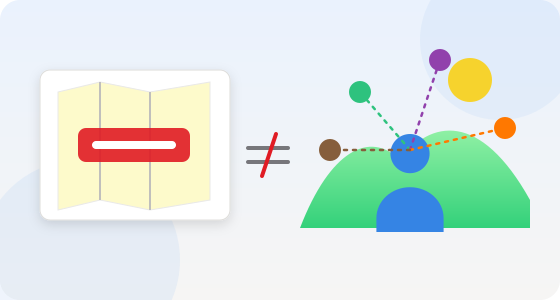</a><br><b><a href="docs/words-matter.ru.md">Слова — это не люди</a></b><br>Карта — не территория: общая семантика Коржибски за одну минуту. Открывается после первого оскорбления.</td>
<td width="33%" align="center"><a href="docs/consequences.ru.md">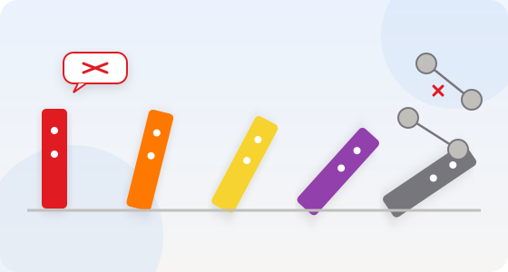</a><br><b><a href="docs/consequences.ru.md">Цена слов</a></b><br>Эскалация как положительная обратная связь — и чем за неё платят люди и планета. После десятого.</td>
<td width="33%" align="center"><a href="docs/sociocyberneering.ru.md">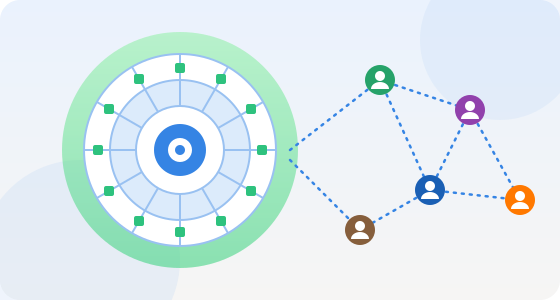</a><br><b><a href="docs/sociocyberneering.ru.md">SocioCyberneering Inc.</a></b><br>Социокибернетика, идеи Проекта Венера Жака Фреско (до 2017 года) и при чём тут CyberCord.</td>
</tr>
</table>

English: [Words are not people](docs/words-matter.en.md) ·
[The price of words](docs/consequences.en.md) ·
[About SocioCyberneering Inc.](docs/sociocyberneering.en.md)

**Читать (PDF, встроены в приложение):**
[Жак Фреско и Проект Венера](assets/pdf/venus-project.pdf) ·
[Наука о Человеке: Общая семантика — что это и зачем нужно?](assets/pdf/general-semantics.pdf)

Материалы по общей семантике:
[archive.org/details/general-semantic-2024](https://archive.org/details/general-semantic-2024).
Михаилу Короткову — отдельная благодарность за переводы.

**Коммуникация с помощью Claude — делайте 3D-визуализации в Claude:**
[видео, с 29:13](https://youtu.be/258cx_PsrRA?t=1753) ·
[SocioCyberneering на YouTube](https://www.youtube.com/watch?v=258cx_PsrRA)

### Как это должно работать: 100 человек в одном голосовом канале

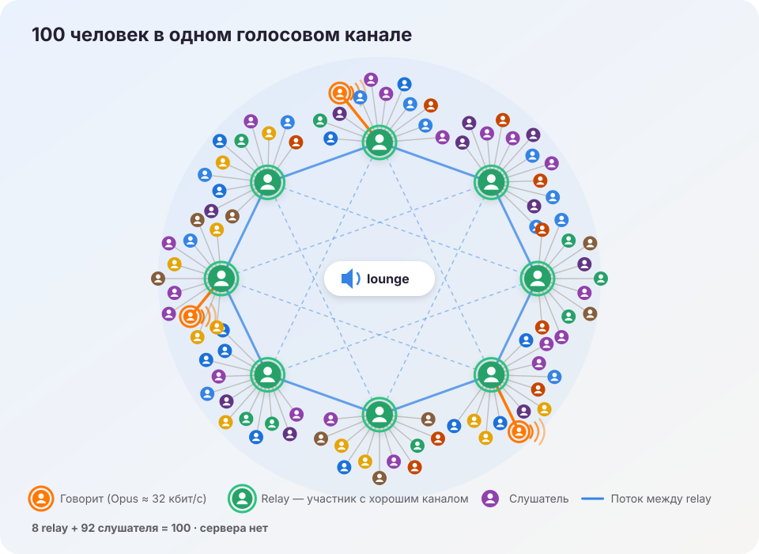

Сервера нет и здесь: роль relay берут на себя участники с хорошим каналом,
которые держат CyberCord в фоне. Каждый слушатель подключён к ближайшему relay,
relay связаны между собой, а пересылаются только три самых громких голоса в
Opus. Слушателю нужно около 96 кбит/с, relay на 12 человек — около 1,2 Мбит/с.
Это план следующих версий; как голос устроен сейчас и что нужно поменять —
в [docs/VOICE-100.md](docs/VOICE-100.md).

---

<p align="center">
  
  
  
  
  
  
  
  
  
</p>

CyberCord похож на Discord, но у него нет центрального сервера и VPS. Каждый
запущенный CyberCord — узел сети. Сообщения, гифки и кружки хранятся у самих
пользователей и передаются от узла к узлу. Работает на GNU/Linux и Windows,
написан на Rust.

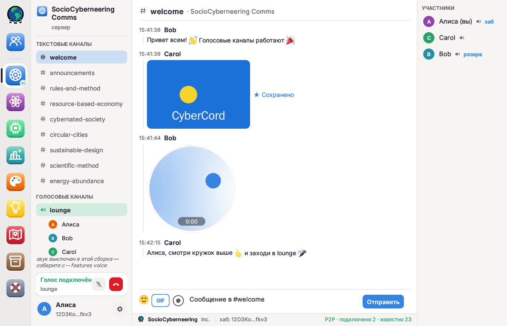

**Скачать:** [последний релиз](https://github.com/sociocyber1/CyberCord/releases/latest) (Linux x86_64).

**Документация:**

- [Экстенсиональная переписка](docs/EXTENSIONAL.md) — подсказки, уровни абстракции, решение проблем, свои эмодзи;
- [Голосовой канал на 100 человек](docs/VOICE-100.md) — как это должно работать;
- [Как устроен протокол](docs/PROTOCOL.md) — транспорт, поиск нод без серверов,
  темы, сообщения, история, файлы как в торренте, голос, хаб, поиск людей,
  статусы, безопасность;
- [Сборка](docs/BUILDING.md) — зависимости, трей, параметры запуска;
- [Как проверить без других людей](docs/TESTING.md) — автотесты и несколько нод
  на одном компьютере;
- [Концепция (PDF)](docs/concept/cybercord-concept.pdf) — исходный документ
  LaTeX (`docs/concept/cybercord-concept.tex`);
- [История версий](CHANGELOG.md) · [Сторонние ресурсы](THIRD_PARTY.md).

## Что нового в 0.15.1

- **Названия каналов на всех 8 языках CyberCord** (русский, украинский,
  английский, немецкий, испанский, французский, китайский, японский): все 77
  текстовых и голосовых каналов. Меняется только отображение — сеть по-прежнему
  встречается в тех же каналах; при наведении виден исходный `#slug`.
  Отключается: Настройки → Язык.

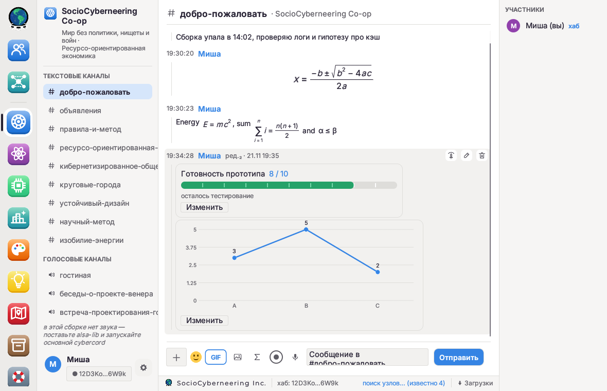

## Что нового в 0.15

- **Формулы LaTeX в чате:** `$…$` в строке и `$$…$$` отдельной строкой —
  дроби, корни, степени и индексы, греческие буквы, ∑ ∫ с пределами,
  `\left( … \right)`. Кнопка **Σ** включает режим формул: панель вставки
  (a/b, √x, xⁿ, ∑, ∫, α, π, ∞, ≤, →…) и живой предпросмотр.
- **Шкала и график в сообщении:** ＋ → «Шкала» (название, значение, «из 5 /
  10 / 100», комментарий) или «График» (столбцы или линия, строки «подпись =
  число»), с предпросмотром. Автор правит их кнопкой «Изменить» — получается
  новая версия с индексом и датой. В тексте это читаемые строки
  `[scale: … = 7/10]` и `[chart bar: …] … [/chart]`.
- **Кнопка с картинкой** — системный выбор файла (Linux через xdg-portal,
  Windows — родной диалог); перетаскивание в окно тоже работает.
- **SocioCyberneering Co-op** вместо «Comms» и девизы серверов: «Мир без
  политики, нищеты и войн · Ресурсо-ориентированная экономика» и другие.
- **Atom-Generator: с чего начать** — документ на сервере: откуда берутся
  атомы (водород и гелий — Большой взрыв, углерод и кислород — звёзды),
  почему «делать атомы» не нужно, зацепка с водородом как источником
  энергии для бактерий, ступени от фотосинтеза до молекулярной сборки,
  энергетический бюджет, первые шаги ([docs/atom-generator.ru.md](docs/atom-generator.ru.md)).

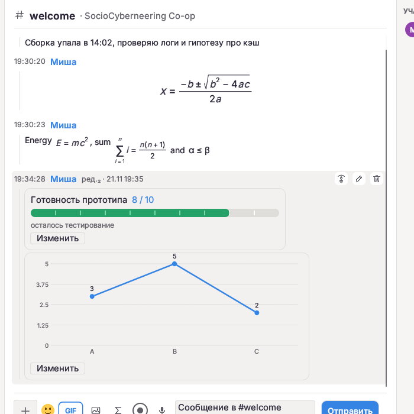

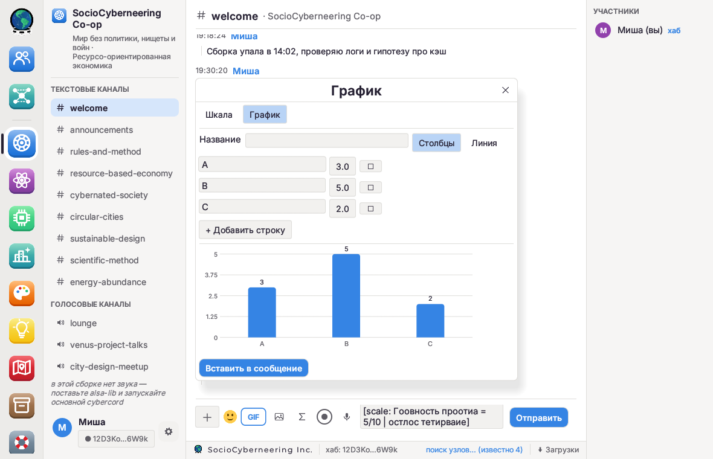

## Что было в 0.14

- **Индексы — не только ₁.** Кнопка «Индекс» сама берёт следующий
  свободный номер: если в чате уже есть Иван₁ и Иван₃, предложит Иван₄. У
  слова с индексом — следующий (Иван₂ → Иван₃). Кнопка «№» открывает выбор
  ₁…₉ и «убрать индекс».
- **Анимация «взлом» в духе Watch Dogs:** новое сообщение проступает из
  случайных символов, затем короткий глитч (смещение цветов) — меньше
  секунды. Так же появляется название SocioCyberneering Inc. при запуске.
  Отключается: Настройки → Внешний вид.
- **Фирменный шрифт:** «SocioCyberneering Inc.» везде набирается Montserrat
  с разрядкой — в приложении, на баннере, в README (`assets/brand/`).
- **Читалка PDF** (pure Rust, hayro): листание, масштаб, «Сохранить»,
  «Открыть в системе». Встроены два документа — «Жак Фреско и Проект Венера»
  и «Наука о Человеке: Общая семантика — что это и зачем нужно?»; ссылки на
  них стоят там, где о них говорится (тексты о Коржибски и Фреско, «О
  SocioCyberneering Inc.», О программе). Скачанные в чате PDF тоже
  открываются кнопкой «Читать».

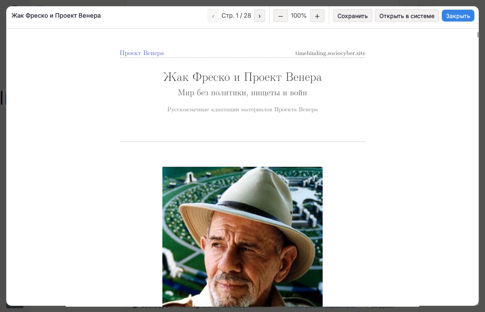

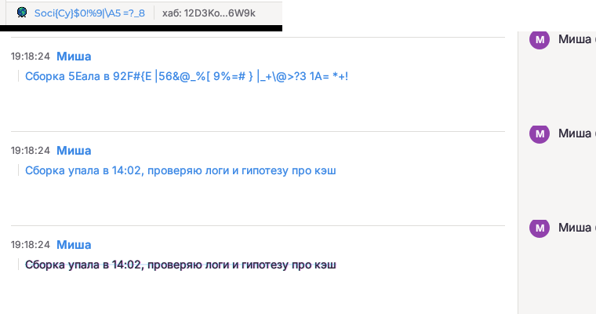

## Что было в 0.13 — экстенсиональная переписка

Главное внимание — чатам: говорить ближе к фактам и не прыгать к выводам.
Ничего не блокируется, всё работает локально. Подробно —
[docs/EXTENSIONAL.md](docs/EXTENSIONAL.md).

- **Выделил слово — подсказка с кнопками:** Индекс₁, Дата (сегодняшняя,
  Иван²¹·¹¹·²⁰²⁶), «Кавычки», и т.д., через-дефис, «для меня».
- **Предупреждения до конфликта** прямо при наборе: обобщения, ярлыки на
  человека, чтение мыслей, «или-или», «очевидно», оценки, требования. Если
  разговор накаляется у нескольких участников — полоса «Сверьте факты,
  проверьте гипотезы, сделайте паузу».
- **Наука, а не вера:** признаки догматичного, сектантского разговора
  («единственная истина», «не задавай вопросов», «учитель всегда прав»…)
  подсвечиваются с напоминанием о проверке.
- **Уровни абстракции** у любого сообщения — разбор по структурному
  дифференциалу: описание, вывод, оценка, с объяснениями.
- **Решение проблем в чате:** кнопка ＋ — чек-лист, таблица, плюсы и минусы,
  «шесть шагов» из рабочей тетради, цель SMART, сверка фактов; таблицы и
  чек-листы отображаются в сообщениях; многострочное поле (Shift+Enter).
- **Свои эмодзи** по общей семантике и SocioCyberneering (20 штук) и пять
  анимированных стикеров.

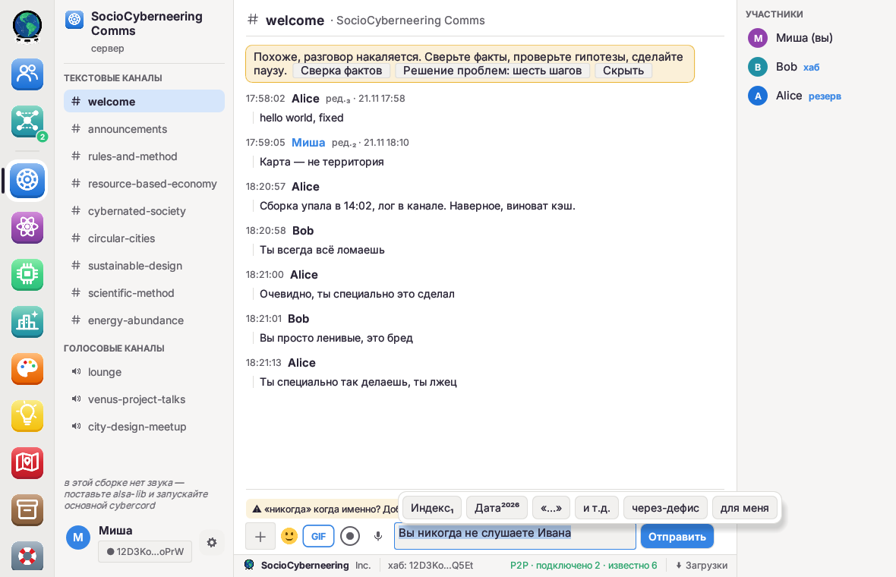

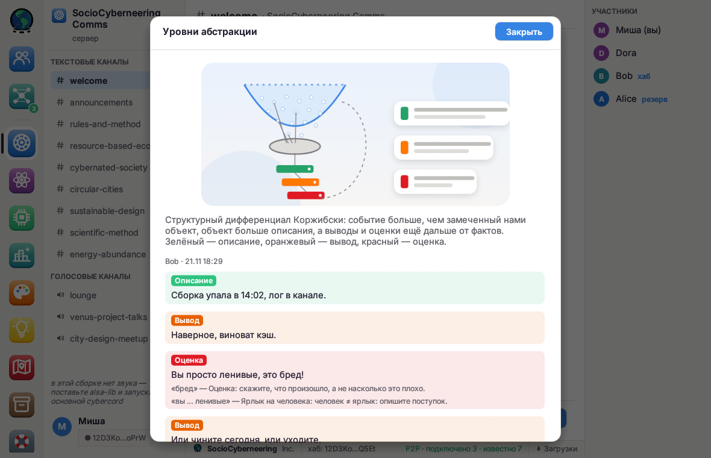

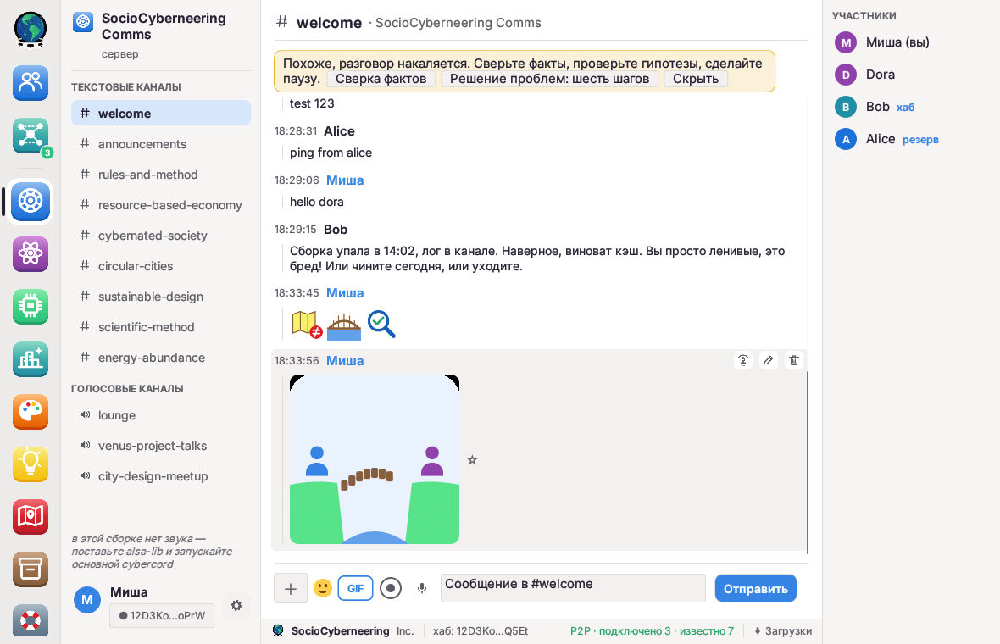

## Что было в 0.12

- **Правка и удаление своих сообщений.** Наведите на своё сообщение: ✎ —
  изменить, 🗑 — удалить (второй клик подтверждает). Стрелка ↑ в пустом поле
  открывает правку последнего сообщения, Esc — отмена.
- **Индекс и дата, как в общей семантике.** У исправленного сообщения стоит
  «ред.₂ · 21.11 18:10»: сообщение₁ ≠ сообщение₂. При наведении видны все
  версии с датами — прошлое не переписывается незаметно.
- **Без сервера, но безопасно.** Каждое сообщение подписано ключом автора;
  правку или удаление примет только та нода, которая видит подпись того же
  автора — и при синхронизации истории тоже. Подробно —
  [протокол, раздел 5а](docs/PROTOCOL.md).
- Время в чате теперь местное.

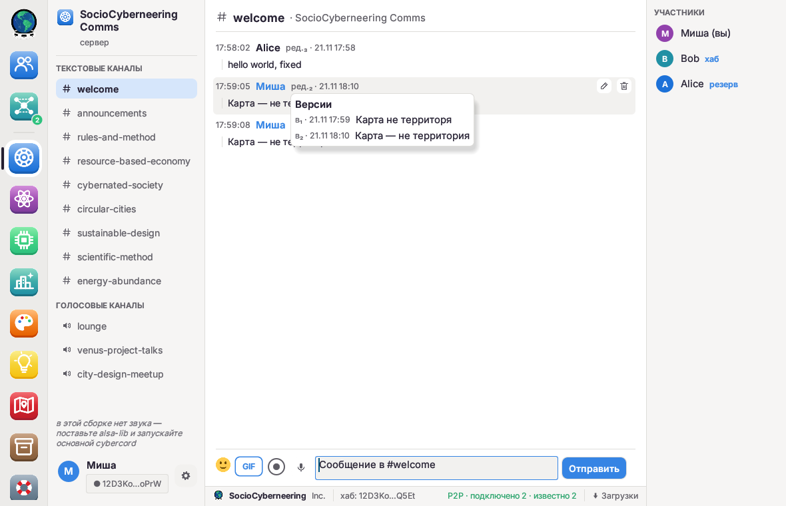

## Что было в 0.11

- **«Слова имеют значение».** Если в вашем сообщении есть оскорбление или мат,
  сообщение всё равно отправляется как есть — без цензуры, лимитов и банов.
  - В первый раз CyberCord откроет только вам текст
    [«Слова — это не люди»](docs/words-matter.ru.md), на десятый —
    [«Цена слов»](docs/consequences.ru.md). В остальные разы — одна строка
    внизу, не чаще раза в 10 минут.
  - Проверка идёт только на вашем компьютере и только для того, что пишете вы;
    счётчик хранится в ваших настройках и никуда не передаётся.
  - Распознаются русский, украинский, английский, немецкий, испанский,
    французский, китайский и японский (простые списки слов, без попыток
    «поймать» обходы).
  - Отключить, перечитать тексты и сбросить счётчик: Настройки → Помощь.
- **Документ о SocioCyberneering Inc.** — Настройки → О программе.
- Иллюстрации в стиле GNOME к документам и схема
  [голосового канала на 100 человек](docs/VOICE-100.md).

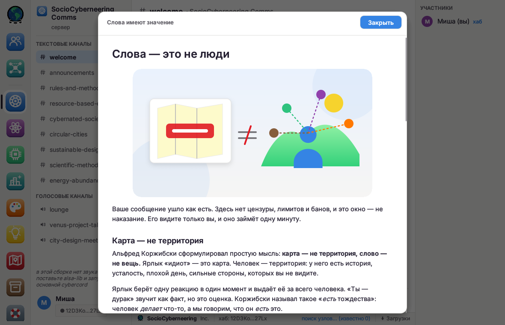

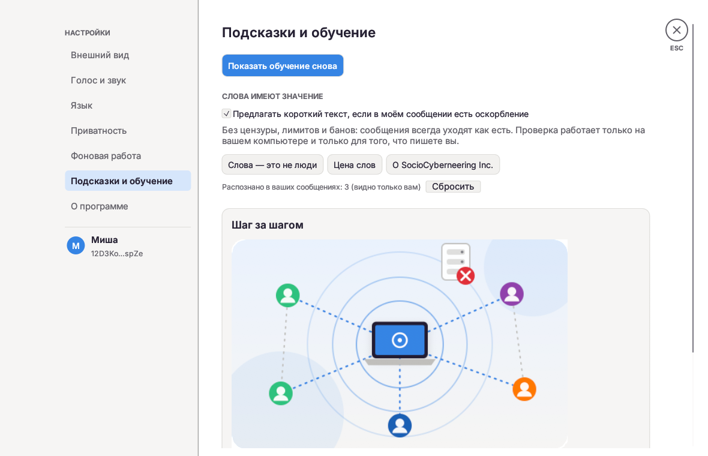

## Что было в 0.10

- **Работа в фоне и трей.** Крестик не закрывает CyberCord, а прячет в трей:
  нода продолжает передавать сообщения, служить relay и раздавать файлы.
  - Меню трея:
    - **Открыть CyberCord**;
    - **Искать новых пользователей** (вкл/выкл);
    - **Статус**;
    - **Уведомления**;
    - **Выход**.
  - Где работает трей:
    - **Xfce** — элемент панели «Status Tray»;
    - **KDE, Cinnamon, MATE** — без дополнительных настроек;
    - **GNOME** — нужно расширение «AppIndicator and KStatusNotifierItem Support»
      (в Ubuntu уже стоит);
    - **Windows 10/11** — область уведомлений.

    Если трея нет, окно при закрытии сворачивается, а нода всё равно работает.
  - Можно включить **автозапуск вместе с системой** свёрнутым в трей
    (Настройки → Фоновая работа).
- **Статусы:**
  - без статуса, в сети, невидимка;
  - работаю, сплю, чем-то занят(а), учусь, отдыхаю, играю, читаю.

  Статус видят друзья, участники каналов, поиск и карта. Выбирается по клику на
  своё имя внизу слева или в трее.
- **Уведомления** о личных сообщениях и упоминаниях вашего имени, когда окно
  скрыто или не в фокусе.
- **Файлы как в торренте** — любой файл до 8 ГБ:
  - перетащите файл в чат, у всех появится карточка с кнопкой **«Скачать»**;
  - файл качается кусками по 256 КБ сразу у всех, у кого он есть, каждый кусок
    проверяется по хэшу, в конце проверяется файл целиком;
  - **если сейчас никого с файлом нет**, загрузка ждёт и начинается сама, когда
    в сети появится кто-то с этим файлом — не обязательно автор;
  - недокачанное **переживает перезапуск**: продолжается с того же места;
  - скачанное вы раздаёте дальше, недокачанные куски — тоже;
  - экран **«Загрузки и раздачи»** — кнопка «⬇ Загрузки» внизу справа;
  - файлы сохраняются в `~/Загрузки/CyberCord` (папка загрузок системы).

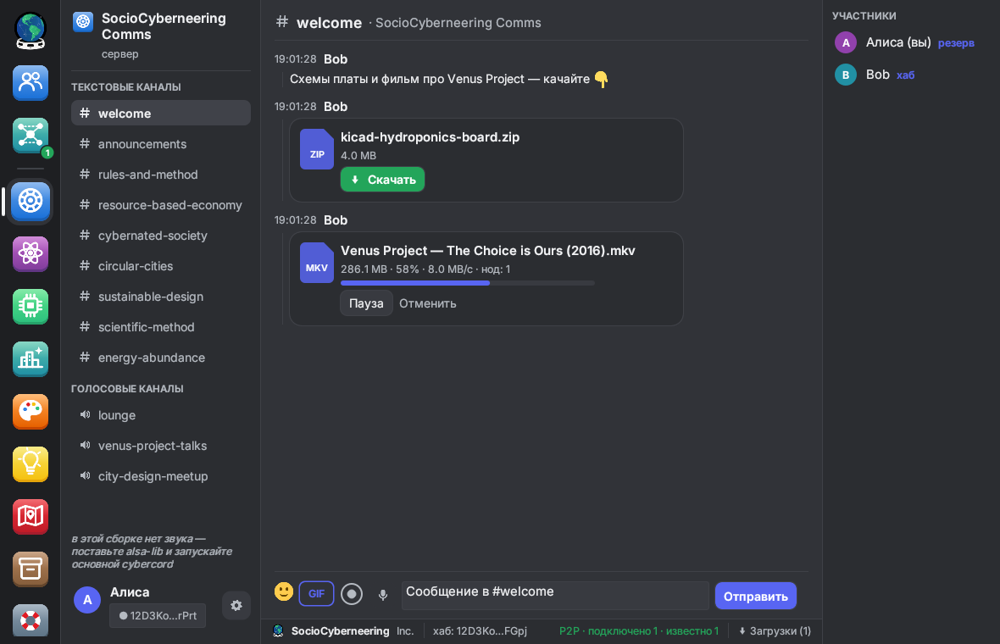

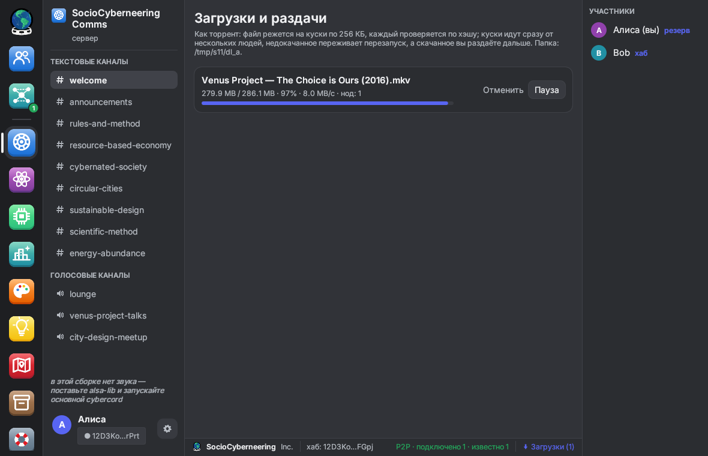

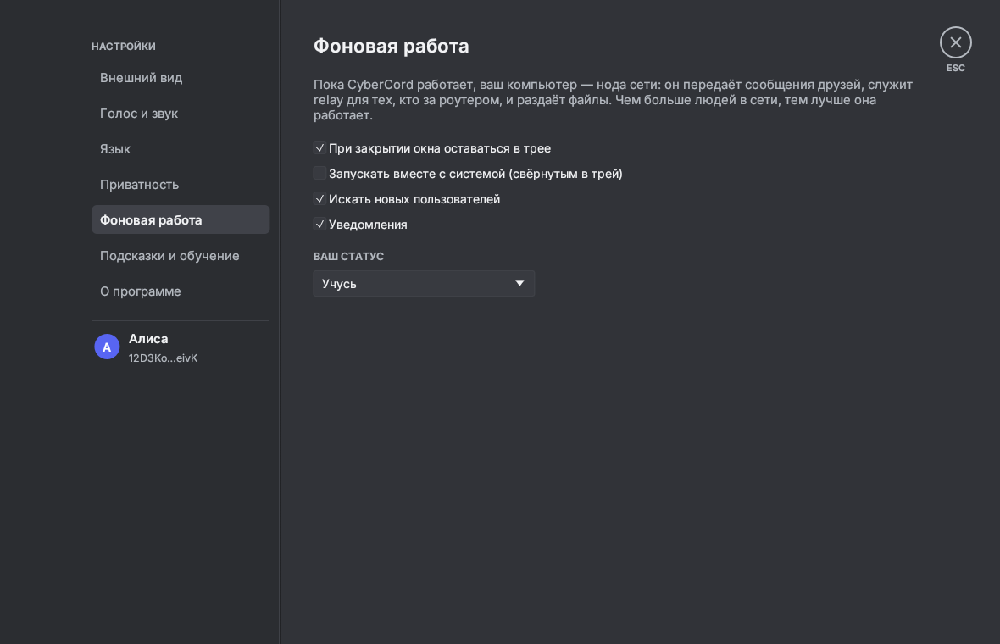

## Что было в 0.9

- **Карта сети** (иконка с узлами на левой панели).
  - Вы в центре, вокруг на орбитах:
    - **ближняя** — те, с кем есть соединение;
    - **средняя** — люди, которые сейчас в сети где-то в сети;
    - **дальняя** — известные ноды, которые сейчас офлайн.
  - Цвет линии показывает тип соединения: зелёная — локальная сеть, синяя —
    напрямую через интернет, фиолетовая пунктирная — через relay другого
    пользователя. По линиям бегут «пакеты» — соединение живое.
  - По клику на точку открывается карточка: кто это, как вы связаны, откуда о
    нём узнали, кнопки **«Добавить в друзья»** и **«Написать»**.
- **Поиск людей** в разделе «Друзья» и на карте: по имени (любое слово,
  латиница и кириллица) или по началу ID. Поиск идёт сразу по двум источникам:
  - по «пульсу» сети — каждая нода раз в 5 секунд сообщает своё имя;
  - по **индексу имён в Kademlia DHT** — каждая нода объявляет префиксы своего
    имени, поэтому находятся и люди, до которых «пульс» ещё не дошёл.

  Каталог увиденных людей сохраняется на диск, поэтому их можно найти и
  добавить, даже когда они офлайн.
- **Глобальная точка встречи без своих серверов — DHT BitTorrent.**
  - Ноды, до которых можно достучаться из интернета, объявляют себя под общим
    ключом CyberCord, а все остальные ищут этот ключ. Так первый вход в сеть
    больше не требует той же Wi-Fi или кода друга.
  - DHT BitTorrent — это миллионы обычных компьютеров без владельца.
  - Включено по умолчанию, выключается в Настройки → Приватность.
- **Приватность:**
  - «Разрешить находить меня по имени» (по умолчанию включено);
  - «Глобальный поиск через DHT BitTorrent» — с честным объяснением, что
    другие участники DHT видят, что ваш IP пользуется CyberCord.

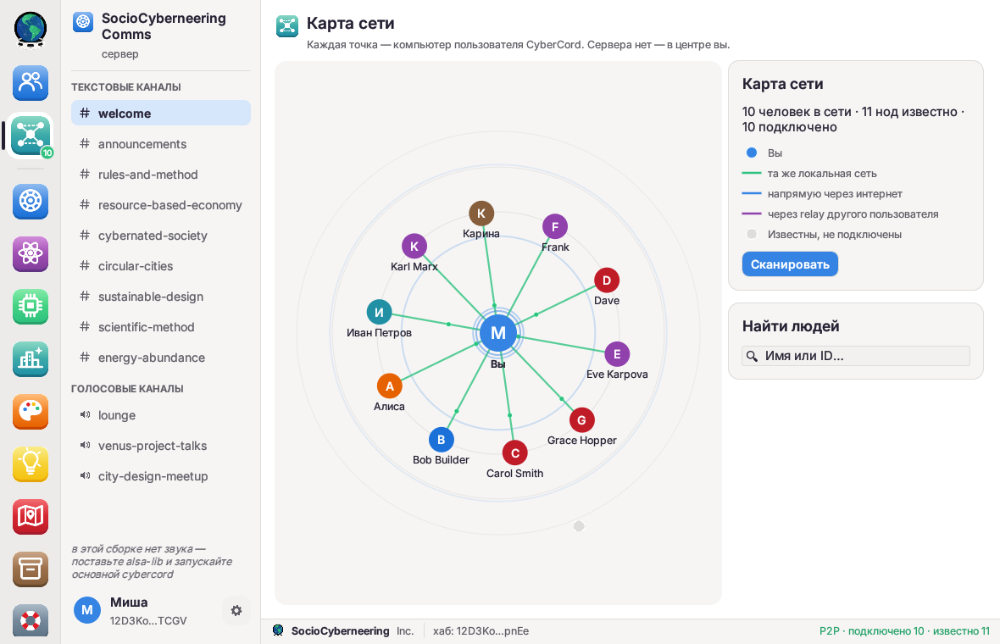

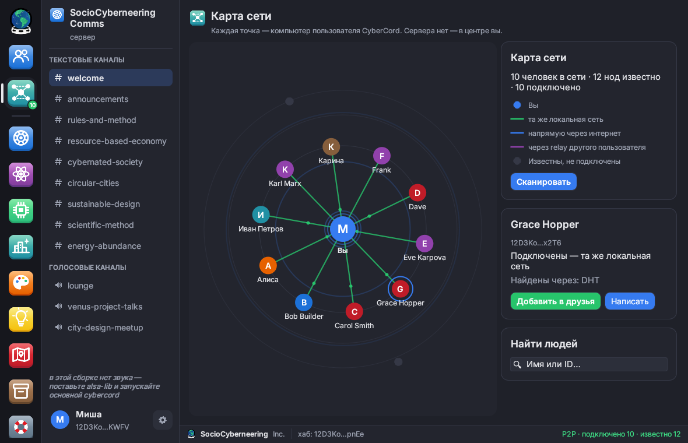

## Как CyberCord находит других без серверов

**CyberCord не сканирует интернет.** Перебирать чужие IP-адреса медленно,
выглядит как атака, и провайдеры за это блокируют. Вместо этого используются
только адреса, которые ноды **сами о себе объявили**:

| Источник | Как работает |
|---|---|
| Локальная сеть (mDNS) | ноды в одной Wi-Fi/LAN видят друг друга сами |
| Сохранённые ноды | все, с кем вы встречались, запоминаются на диск |
| Друзья | адреса из кода подключения |
| Обмен списками | каждые 15 с соседи рассказывают о нодах, которых знают |
| Kademlia DHT | поиск ноды по ID и индекс имён для поиска людей |
| **DHT BitTorrent** | глобальная точка встречи: ноды с открытым портом объявляют себя под ключом CyberCord |
| Relay + hole punching | ноды за NAT соединяются через ноду другого пользователя, затем пробуют напрямую |

Как это проверено: интеграционный тест `tests/global_rendezvous.rs`
поднимает локальную DHT BitTorrent из 10 узлов. Две ноды CyberCord без адресов,
без кодов и без LAN-поиска находят друг друга примерно за 15 секунд.

## Что было в 0.8

- **Настройки как в Discord.** Они открываются на весь экран, разделы слева:
  «Внешний вид», «Голос и звук», «Язык», «Подсказки и обучение», «О программе».
  Закрыть — ✕ или Esc.
- **8 тем:**
  - GNOME светлая и тёмная;
  - в стиле Discord: тёмная, светлая, полночь;
  - в стиле Kali: тёмная, Purple и «терминал» с моноширинным шрифтом.

  Темы переключаются сразу. Это только цветовые схемы, без логотипов Discord и
  Kali.
- **Размер интерфейса** от 80 до 150 %.
- **Громкость микрофона и звука** от 0 до 200 %. Действует везде: голосовой
  чат, музыка, голосовые сообщения, кружки.
- **Чувствительность ввода, как в Discord.** Тихий звук (фон, клавиатура)
  собеседникам не отправляется. Есть два режима:
  - **автоматический** — порог следует за фоновым шумом;
  - **ручной** — перетащите отметку на полосе уровня.
- **Проверка микрофона вживую.** Нажмите «Проверить» и сразу услышите себя.
  Ниже бежит волна голоса: зелёные столбики слышат другие, серые отсекаются
  порогом.

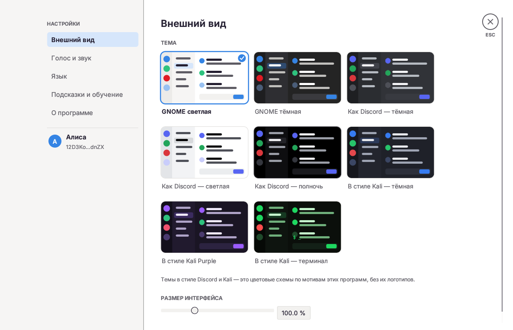

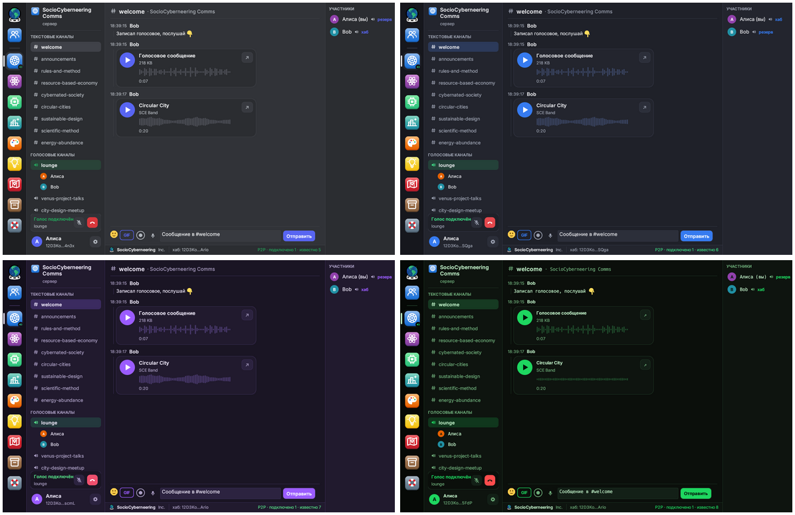

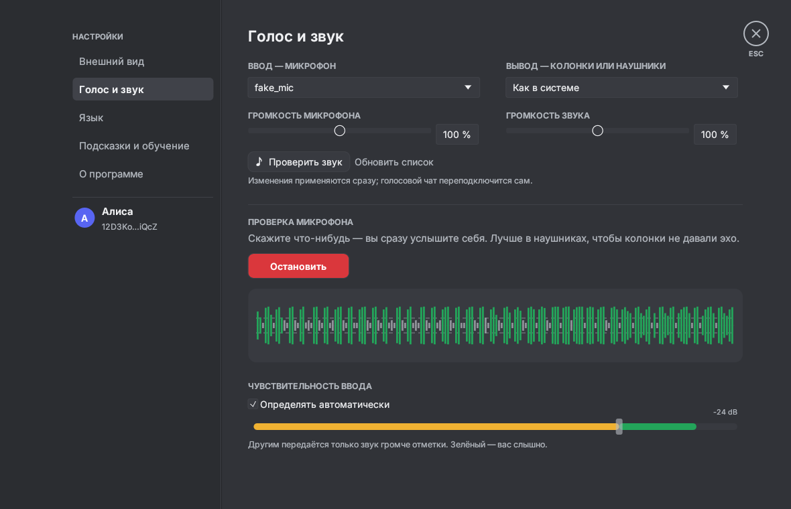

## Что было в 0.7

- **Голосовые сообщения.** Кнопка 🎤 в строке ввода начинает запись. Пока идёт
  запись, видны таймер и живая волна голоса. Enter или «Отправить» — отправить,
  Esc — отмена. Длина до 5 минут. В чате голосовое выглядит как плеер с волной и
  перемоткой.
- **Настройки → Голос и звук:**
  - выбор **вывода** (колонки или наушники) и **ввода** (микрофон);
  - **«Проверить звук»** проигрывает короткий сигнал;
  - **«Проверить микрофон»**: 5 секунд записи с индикатором уровня, затем вы
    слышите себя. Если микрофон молчит, CyberCord так и скажет.

  Изменения применяются сразу, голосовой чат переподключается сам.
- **Исправлено:**
  - Голосовой чат передавал звук с частотой устройства (например, 44,1 кГц),
    но помечал его как 48 кГц, поэтому у собеседников голос мог звучать выше
    или ниже. Теперь звук приводится к 48 кГц на входе и выходе.
  - Запись с микрофона ограничена по длине, память не растёт бесконечно.

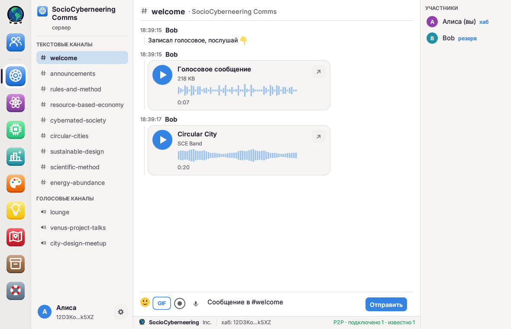


## Что было в 0.6

- **Музыка в чате.** Перетащите в окно mp3, flac, ogg, wav или m4a (до 16 МБ),
  и у всех в канале появится плеер:
  - ▶ / пауза;
  - волна трека, по которой можно перематывать;
  - время;
  - название и исполнитель из тегов файла.

  Кнопка ↗ открывает трек в вашем обычном плеере.
- **Звук в готовой сборке.** Музыка, звук видео-кружков и голосовые каналы
  теперь работают сразу, без самостоятельной сборки. Нужна системная библиотека
  ALSA (`libasound.so.2`), она есть почти в любом Linux с PulseAudio или
  PipeWire. Если её нет, используйте `cybercord-nosound` из архива. В этом
  режиме кнопка ▶ открывает трек в системном плеере.

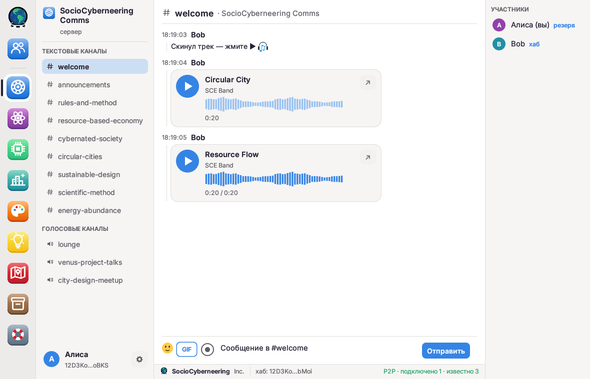

## Что было в 0.5

- **Голосовые каналы как в Discord** — по 3 на каждый сервер. Видно, кто в
  какой комнате; зелёное кольцо значит, что человек говорит. Внизу есть панель
  «Голос подключён» с кнопками микрофона и выхода.
- **Иконки серверов** в стиле приложений GNOME и символьные иконки (микрофон,
  динамик, шестерёнка и т. д.).
- **Шрифт Inter** встроен в приложение (на нём основан Adwaita Sans в GNOME):
  настоящий полужирный, крупнее и читаемее.
- **Эмодзи** (Twemoji, цветные): выбор по категориям, поиск, `:коды:`.
  Сообщение только из эмодзи показывается крупно.
- **GIF и картинки**: перетащите файл в окно или выберите из «Ваших GIF» (★).
- **Видео-кружки** с веб-камеры, как в Telegram: до 60 секунд. В чате кружок
  играет без звука, по нажатию — со звуком.
- **8 языков**: русский, украинский, английский, немецкий, испанский,
  французский, китайский и японский. Язык выбирается автоматически по системе,
  его можно сменить в ⚙.
- **Обучение всплывающими подсказками** с анимацией при первом запуске и
  пошаговый гайд с картинками на главной.
- Исправлено:
  - История и медиа иногда не приходили новым участникам: gossipsub отбрасывал
    повторы как дубликаты. Теперь каждый новичок получает всё.
  - Файл личности (ваш ID) теперь всегда лежит в папке данных, а не в текущей
    папке.

## Установка (Linux)

Скачайте `cybercord-0.15.1-linux-x86_64.tar.gz` со страницы
[Releases](https://github.com/sociocyber1/CyberCord/releases/latest) и выполните:

```bash
tar xf cybercord-0.15.1-linux-x86_64.tar.gz
cd cybercord-0.15.1-linux-x86_64
./install.sh          # CyberCord появится в меню приложений
```

Для веб-камеры пользователь должен быть в группе `video`:
`sudo usermod -aG video $USER`, затем перезайдите в систему.

Требования:

- glibc 2.39+ (Arch, Artix, Fedora 40+, Ubuntu 24.04+);
- alsa-lib (`libasound.so.2`), она обычно уже стоит.

Если alsa-lib нет, `install.sh` сам поставит версию без звука, или запустите
`./cybercord-nosound` вручную.

## Шаг за шагом

Эти же картинки есть внутри приложения, на главной (★) в карточке «Шаг за шагом».

### 1. Запустите CyberCord — он ищет узлы


Сервера нет. CyberCord находит других пользователей:

- в вашей Wi-Fi или локальной сети;
- среди сохранённых узлов;
- через друзей;
- по спискам, которыми делятся другие узлы.

Внизу окна видно, сколько узлов подключено.

### 2. Скопируйте свой код


Нажмите  (Друзья) слева, затем
**«Скопировать код»**. Отправьте код другу любым мессенджером или почтой. Если
друг уже в сети, хватит одного ID.

### 3. Добавьте друга


Вставьте код друга в **«Добавить друга»** и нажмите **«Добавить»**. Когда друг в
сети, точка рядом с его именем зелёная. Нажмите на имя, чтобы писать ему.
Кнопка **«Позвонить»** начинает личный звонок.

### 4. Пишите с эмодзи и гифками


Выберите канал или друга, напишите сообщение и нажмите Enter.

- 🙂 открывает эмодзи;
- **GIF** открывает вашу коллекцию;
- `.gif`, `.png` или `.jpg` можно просто перетащить в окно.

Чтобы сохранить чужую гифку себе, нажмите ☆ рядом с ней.

**Музыка:** перетащите mp3, flac, ogg, wav или m4a в окно, или укажите путь в
панели GIF → «Отправить файл». В сообщении появится плеер. Нажмите ▶, чтобы
слушать; нажмите на волну, чтобы перемотать. Одновременно играет один трек. Файл
хранится у всех, кто его получил, поэтому трек можно послушать, даже когда
отправитель не в сети.

### 5. Запишите видео-кружок


Круглая кнопка ◉ рядом с GIF включает веб-камеру. Запись длится до 60 секунд,
затем нажмите **«Остановить и отправить»**. В чате кружок крутится без звука;
нажмите на него, чтобы послушать.

### 6. Говорите в голосовых каналах

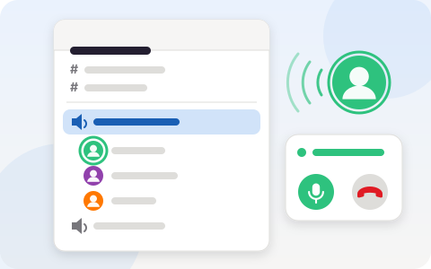

Под текстовыми каналами каждого сервера есть 3 голосовых. Нажмите на канал,
чтобы войти, затем включите 🎤 в панели «Голос подключён» внизу. Под каналом
видно, кто в комнате. Красная кнопка — выйти.

| Сервер | Голосовые каналы |
|---|---|
| SocioCyberneering Co-op | lounge · venus-project-talks · city-design-meetup |
| Atom-Generator | lab-talk · feynman-reading · office-hours |
| Automation | pcb-review · embedded-hangout · hydroponics-lab |
| AI Design | design-studio · simulation-jam · claude-news-live |
| ART | studio · critique-live · chill-and-draw |
| Creativity | brainstorm · writers-room · jam-session |
| General-Semantics | discussion · reading-club-live · e-prime-practice |
| Archives | reading-room · paper-discussion · study-together |
| Help | live-help · onboarding · dev-sync |

## Обучение и языки

При первом запуске CyberCord показывает тур из 9 подсказок. Каждая подсвечивает
нужную часть окна. Повторить тур: ⚙ → «Показать обучение».

Язык берётся из системы (`LANG`). Сменить его можно в ⚙ → «Язык».

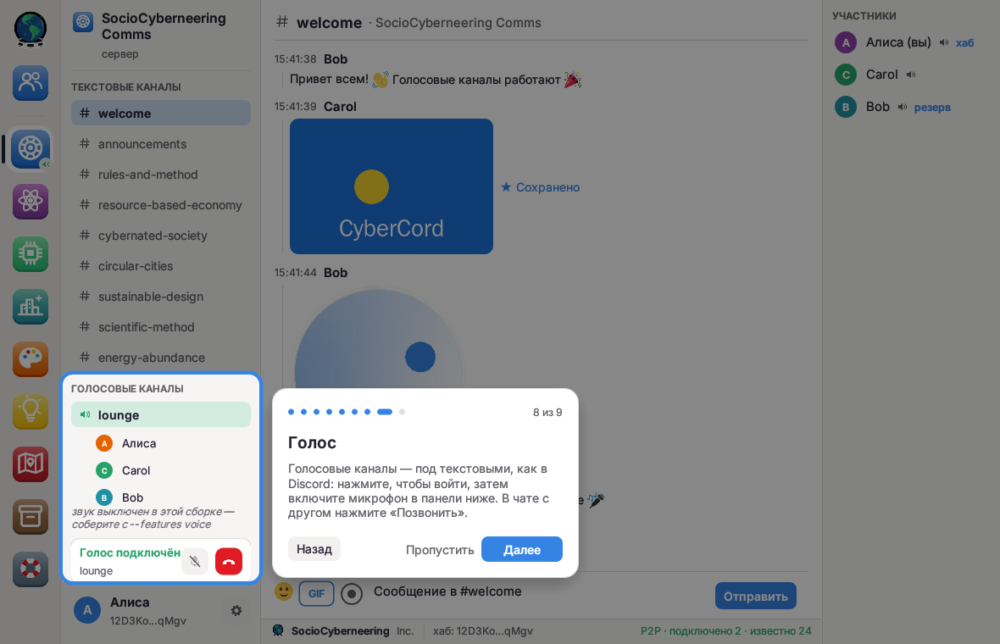

## Как устроена сеть (без серверов)

1. **Локальная сеть.** Другие CyberCord в той же Wi-Fi/LAN находятся сами (mDNS).
2. **Сохранённые узлы.** Все узлы, с которыми вы встречались, запоминаются.
3. **Друзья.** CyberCord берёт адреса из кода подключения друга.
4. **Обмен списками.** Каждый узел рассказывает соседям об известных ему узлах.
5. **DHT (Kademlia).** Друга можно найти только по ID, через других пользователей.
6. **За NAT.** Узел другого пользователя, до которого можно достучаться, служит
   relay. Затем hole punching пытается соединить вас напрямую. При наличии UPnP
   CyberCord сам открывает порт 47100.

CyberCord подключается только к узлам, которые сами о себе сообщили, и не
перебирает случайные адреса в интернете. Для самого первого входа нужна одна
«дверь»: та же сеть или код друга.

Медиа (GIF, картинки, кружки) передаются кусками и проверяются по хэшу BLAKE3.
Файл хранится у каждого, кто его получил, поэтому его можно скачать, даже если
автор не в сети.

## Проверить одному, без других людей

```bash
scripts/peers.sh 3                      # 3 консольных узла на этом компьютере
./cybercord --name Я                    # окно найдёт их через mDNS
```

Команды консольного режима (`--headless`, затем `/help`):

| Команда | Что делает |
|---|---|
| `/voice sce/lounge` | войти в голосовой канал |
| `/leave` | выйти из голосового канала |
| `/send file.gif` | отправить GIF или картинку |
| `/circle 3` | записать и отправить видео-кружок на 3 секунды |
| `/send song.mp3` | отправить музыку |
| `/play` / `/play файл.mp3` | включить последний трек в канале или файл |
| `/stop` | остановить музыку |
| `/voicemsg 5` | записать голосовое на 5 секунд и отправить |
| `/devices` | список микрофонов и колонок |
| `/find кар` | найти людей по имени |
| `/nodes` | ноды, которые знает эта нода (карта сети в тексте) |
| `/share файл` | поделиться файлом любого размера (как торрент) |
| `/get имя` | скачать файл из канала (ждёт, если владельцев нет в сети) |
| `/files` | загрузки и раздачи |
| `/pause`, `/resume`, `/cancel имя` | управление загрузкой |
| `/code` | показать свой код подключения |
| `/addfriend Имя <код>` | добавить друга |
| `/dm Имя текст` | написать другу |
| `/net` | состояние сети |

`CYBERCORD_TEST_CAMERA=1` подставляет тестовую «камеру», если веб-камеры нет.

## Сборка из исходников

```bash
cargo build --release                           # чат, GIF, эмодзи, языки
cargo build --release --features camera         # + веб-камера (кружки)
sudo pacman -S --needed alsa-lib                # (Arch/Artix) для звука
cargo build --release --features voice,camera   # + микрофон и звук
```

Windows: `cargo build --release --features voice,camera` (звук через WASAPI,
камера через Media Foundation).

## Честно о текущих ограничениях

- Звук проверен на виртуальных устройствах ALSA: двух «колонках» и
  «микрофоне», который читает тон из файла.
  - Музыка ушла именно в выбранное устройство, с правильными нотами.
  - Голосовое сообщение с «микрофона» дошло до другого узла, в нём тон 330 Гц
    нужной громкости.
  - Проверка микрофона записала тон и проиграла его в выбранные наушники. Настоящие колонки и микрофон, а также
  голосовой чат между живыми людьми здесь не проверены.
- Не проверено здесь:
  - настоящая веб-камера (проверена тестовая; запись с реальной камеры
    использует nokhwa/V4L2);
  - работа через реальный интернет. Проверено на одной машине, включая relay
    между двумя «NAT»-узлами.
- Голос пока без шумоподавления и без Opus (несжатый PCM) и рассчитан на
  небольшие комнаты; план на 100 человек — в [docs/VOICE-100.md](docs/VOICE-100.md).
- Личные сообщения шифруются на уровне соединения (Noise), но не сквозным
  шифрованием ключами друзей. Узел, который знает ID обоих, может подписаться на
  их канал. MLS запланирован.

## Лицензии ресурсов

- Эмодзи: [Twemoji](https://github.com/jdecked/twemoji), © Twitter/X и
  участники, CC-BY 4.0.
- Шрифт: [Inter](https://rsms.me/inter/), © The Inter Project Authors, SIL OFL 1.1
  (`assets/fonts/LICENSE-Inter.txt`).
- Фирменный шрифт: [Montserrat](https://github.com/JulietaUla/Montserrat),
  © The Montserrat Project Authors, SIL OFL 1.1 (`assets/fonts/LICENSE-Montserrat.txt`).
- Чтение PDF: [hayro](https://github.com/LaurenzV/hayro), Apache-2.0 / MIT.
- Иконки серверов и иллюстрации: SocioCyberneering Inc., нарисованы для
  CyberCord (`tools/make_icons.py`, `tools/make_guide.py`,
  `tools/make_docs_art.py`, `tools/make_readme_art.py`, `tools/make_emoji.py`, `tools/make_gifs.py`).

---

### English (short)

**0.15:** LaTeX formulas in chat (`$…$`, `$$…$$`) with a formula mode, snippet bar and live preview; scale and chart blocks with a friendly editor (authors edit them into a new indexed version); an image button with the system file dialog; "SocioCyberneering Co-op" and server mottos; an "Atom-Generator: where to start" document.

**0.14:** smart indices (next free number from the chat, or pick ₁…₉), a short Watch Dogs-style "hacked text" + glitch animation for new messages (can be turned off), the SocioCyberneering Inc. brand always set in Montserrat, and a built-in PDF reader (hayro) with two embedded documents (in Russian) linked wherever they are mentioned.

**0.13 — extensional chat:** select a word for an index₁, today's date, safety quotes, etc., hyphen or "to me"; live hints for allness, labels on people, mind reading, either-or, jumping to conclusions, loaded evaluations and demands; a "the conversation is heating up — check facts, test hypotheses" banner; dogmatic/cult-like wordings flagged ("we go by science"); a "levels of abstraction" view per message (structural differential: description / inference / evaluation); problem-solving blocks (check lists, tables, pros/cons, six steps, SMART, fact check) rendered in chat; multi-line composer; 20 own general-semantics/SocioCyberneering emoji and 5 animated stickers. Nothing is blocked; everything runs locally ([details, ru](docs/EXTENSIONAL.md)).

**0.12:** edit and delete your own messages (hover ✎/🗑, ↑ to edit the last one). Edited messages show a version index and date, general-semantics style ("edited₂ · 21.11 18:10"), with all versions on hover. Every message is now signed by its author, so edits and deletes are accepted only from the author, even when history is relayed by other nodes. Local time in chat.

**The idea:** no owner, no centre, no bans, no limits: the network is held by its people, and you are responsible for the future. **0.11** adds "Words matter": if your own message contains an insult it is still sent as written, and only you are shown a short read on general semantics ([Words are not people](docs/words-matter.en.md)), then [The price of words](docs/consequences.en.md) at the tenth time. Local only, can be turned off. Plus [About SocioCyberneering Inc.](docs/sociocyberneering.en.md) and a design for [100 people in one voice channel](docs/VOICE-100.md) ([picture](docs/img/voice-100.en.svg)).

**0.10:** runs in the background with a tray icon (Xfce/KDE/GNOME+AppIndicator via StatusNotifierItem over D-Bus, Windows notification area): Open · Look for new users · Status · Notifications · Quit; autostart; user statuses; desktop notifications for DMs and mentions; torrent-like file sharing up to 8 GB (256 KB verified pieces from several nodes, queue while nobody has it, resume after restart, every downloader seeds).

**0.9:** network map (you in the centre; connected / online / known orbits; link type; click a node to add or message), people search (heartbeat directory + Kademlia name-prefix index), and a global rendezvous through the BitTorrent Mainline DHT — reachable nodes announce under one CyberCord key, everyone else looks it up; no servers of our own, nothing is scanned. Toggles in Settings → Privacy.

**0.8:** full-screen Discord-like settings, 8 themes (GNOME light/dark; Discord-style dark/light/midnight; Kali-style dark/purple/terminal — colour schemes only, no logos), UI size, input/output volume 0–200 %, Discord-style input sensitivity (auto or manual threshold), and a live mic test with a scrolling waveform.

**0.7:** voice messages (🎤 in the composer, up to 5 min), Settings → Sound (pick output/input device, test sound, test microphone with level meter and playback), and live voice is now resampled to 48 kHz on both ends.

**0.6:** music messages (mp3/flac/ogg/wav/m4a) with an in-chat player (waveform, seek), and sound in the prebuilt binary (needs `libasound.so.2`; `cybercord-nosound` is included as a fallback).


CyberCord is a serverless, peer-to-peer Discord-like app in Rust (libp2p + egui).

**0.5 adds:**

- Discord-style voice channels (3 per server) with live room rosters;
- GNOME-style server icons and the embedded Inter font;
- colour emoji, GIFs and images;
- Telegram-style webcam video circles;
- 8 UI languages, picked automatically from the system;
- an animated onboarding tour;
- an illustrated step-by-step guide.

It also fixes history and media sync for late joiners.

Build with `cargo build --release --features camera` (add `voice` for audio).
For testing alone, see `scripts/peers.sh` and `--headless` (`/help`).
