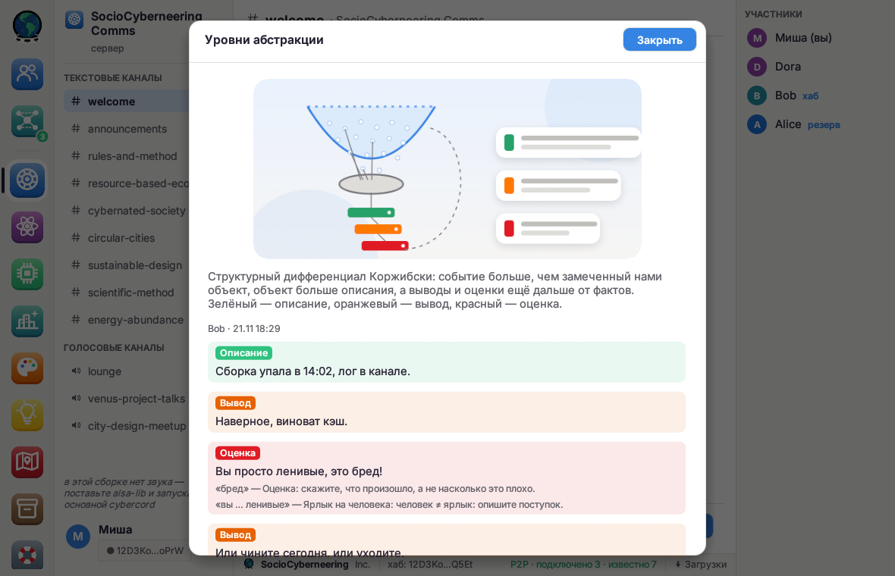
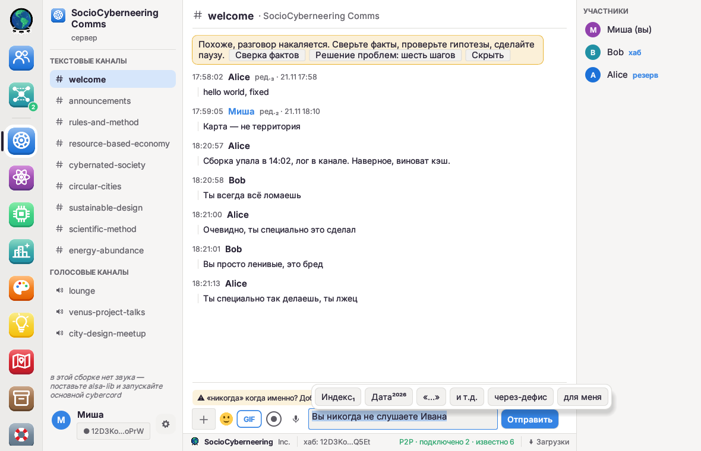
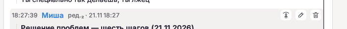
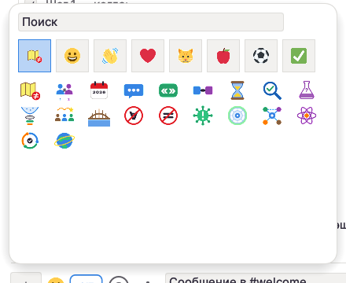

# Экстенсиональная переписка

Чат CyberCord помогает говорить ближе к фактам — по общей семантике
Коржибски. Ничего не блокируется и не скрывается: это подсказки, а решение
всегда за вами. Всё работает локально, на вашем компьютере.

## Подсказка на выделенном слове

Выделите слово в поле ввода — над ним появятся кнопки:

| Кнопка | Что делает | Пример |
|---|---|---|
| **Индекс₁** | нет двух одинаковых | Иван → Иван₁, ещё раз → Иван₂ |
| **Дата** | всё меняется со временем | Иван → Иван²¹·¹¹·²⁰²⁶ (сегодняшняя дата) |
| **«…»** | слово употреблено осторожно | ум → «ум» |
| **и т.д.** | обо всём нельзя сказать всего | … и т.д. |
| **через-дефис** | что связано в природе, не разрывать словами | пространство время → пространство-время |
| **для меня** | оценка принадлежит тому, кто её даёт | скучно (для меня) |

## Предупреждения до конфликта

Пока вы пишете, под полем ввода появляется короткая подсказка, если в тексте
есть то, что часто разжигает спор:

- **обобщение** — «всегда», «никогда», «все»: когда именно?
- **ярлык на человека** — «ты — лжец»: человек ≠ ярлык, опишите поступок;
- **чтение мыслей** — «ты специально»: это догадка, лучше спросите;
- **или-или** — «или с нами, или против»: есть ли третий вариант?
- **прыжок к выводу** — «очевидно», «все знают»: на каких фактах?
- **оценка** — «бред», «ужасно»: что произошло, а не насколько плохо;
- **требование** — «ты должен»: просьба работает лучше.

Если несколько участников за последние 15 минут пишут так в одном канале,
над чатом появляется полоса «Похоже, разговор накаляется. Сверьте факты,
проверьте гипотезы, сделайте паузу» с кнопками «Сверка фактов» и «Решение
проблем: шесть шагов». Её можно скрыть на полчаса.

## Наука, а не вера

Отдельно распознаются признаки догматичного, сектантского разговора:
«единственная истина», «не задавай вопросов», «учитель всегда прав»,
«только мы знаем», «доказательства не нужны», «порви с семьёй»… В таком
канале появляется полоса: «У нас всё по науке: просите проверяемых фактов,
любое утверждение можно проверить». Аристотелево «или-или» и «есть»
тождества — туда же, на свалку истории.

## Уровни абстракции (структурный дифференциал)

У каждого сообщения при наведении есть кнопка «Уровни абстракции». Она
разбирает текст по предложениям:

- **описание** (зелёный) — числа, даты, цитаты, «видел», «написал»;
- **вывод** (оранжевый) — «наверное», «значит», обобщения, догадки;
- **оценка** (красный) — ярлыки, оценочные слова, оскорбления;
- **неясно** — вопросы, приветствия и всё остальное.

К каждой найденной формулировке — объяснение и совет. Это простой помощник
по словам, а не судья: он может ошибаться. Карта — не территория, и этот
разбор — тоже карта.

## Решение проблем прямо в чате

Кнопка **＋** слева от поля ввода вставляет готовые блоки:

- **Чек-лист** (`- [ ]`): автор сообщения может отмечать пункты, каждая
  отметка — новая версия с индексом и датой;
- **Таблица** (`| … | … |`) и **Плюсы и минусы**;
- **Решение проблем: шесть шагов** — по рабочей тетради «Решение проблем»
  SocioCyberneering: одна проблема → все решения → плюсы и минусы → выбор →
  план → итоги;
- **Цель SMART** и **Сверка фактов**.

Поле ввода многострочное: Enter — отправить, Shift+Enter — новая строка.

## Свои эмодзи и стикеры

В выборе эмодзи первая вкладка — 20 своих: карта ≠ территория, индекс, дата,
и т.д., кавычки, дефис, пауза, сверка фактов, гипотеза, структурный
дифференциал, связывание времени, мост, «нет обобщениям», «нет „есть“
тождества», вирус оценок, круговой город, P2P-сеть, атом, научный метод,
глобус SocioCyberneering. В сообщении они идут как `:gs_map:` — старые
версии CyberCord покажут код текстом.

В панели GIF — пять анимированных стикеров: карта ≠ территория, индексы,
пауза, сверка фактов, мост.

Исходники: `src/semantics.rs` (списки слов и разбор), `tools/make_emoji.py`,
`tools/make_gifs.py`.
