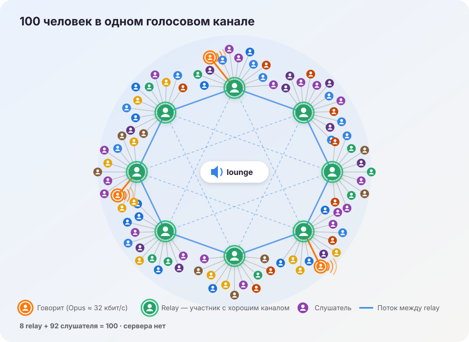

# Голосовой канал на 100 человек

Это план, как голосовые каналы CyberCord должны работать, когда в одном
канале 100 человек, — без сервера и без VPS.

## Как сейчас (0.11)

- Каждый говорящий отправляет кадры по 20 мс в тему комнаты
  `cc/voice/<сервер>/<комната>`; gossipsub пересылает их через несколько
  соседей.
- Звук несжатый: 48 кГц, моно, 16 бит — **768 кбит/с** на говорящего.
- Шумовой порог уже есть: пока человек молчит, ничего не отправляется.
- Хорошо работает для небольших комнат, примерно до 10 человек. На 100
  несжатый звук и пересылка «всем через всех» перегрузят домашние каналы.

## Как должно быть

1. **Сжатие Opus.** ≈ 32 кбит/с вместо 768 — в 24 раза меньше.
2. **Relay из самих участников.** Сеть выбирает ~8 участников с хорошим
   каналом и стабильной работой (тот же пульс и рейтинг, по которому сейчас
   выбирается хаб). Сервера нет: relay — это обычные пользователи, которые
   держат CyberCord в фоне.
3. **Каждый слушатель подключён к одному relay** — к тому, у кого меньше
   пинг; запасной relay наготове, как сейчас «резервный хаб».
4. **Relay связаны между собой** кольцом и хордами: от любого relay до
   любого другого — не больше двух переходов.
5. **Пересылаются только громкие голоса.** Одновременно идут 3 самых
   громких потока; остальные ждут паузы. Так разговор остаётся понятным,
   а нагрузка не растёт с числом людей.

## Сколько это стоит по каналу

| Кто | Получает | Отдаёт |
|---|---|---|
| Слушатель | 3 × 32 = **≈ 96 кбит/с** | 0 (пока молчит) |
| Говорящий | ≈ 96 кбит/с | **32 кбит/с** своему relay |
| Relay (12 слушателей) | ≈ 96–200 кбит/с | 12 × 96 ≈ **1,2 Мбит/с** + соседним relay |

Задержка: говорящий → relay → (relay) → relay → слушатель — до четырёх
переходов по сети вместо одной поездки на далёкий сервер.

## Почему так

Чем больше людей держат CyberCord в фоне, тем больше хороших relay и тем
легче каждому. Это и есть кооперация вместо центра: сеть держат люди.

См. также: [протокол](PROTOCOL.md) · [Слова — это не люди](words-matter.ru.md) ·
[О SocioCyberneering Inc.](sociocyberneering.ru.md)
