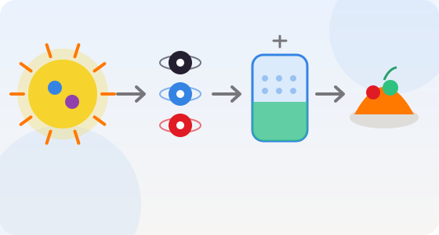
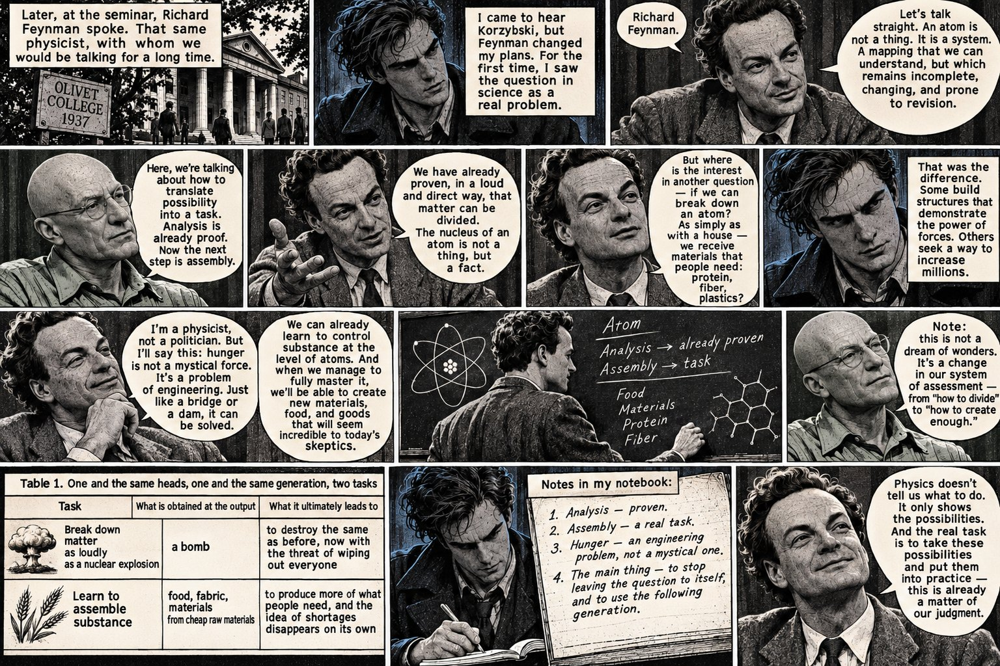
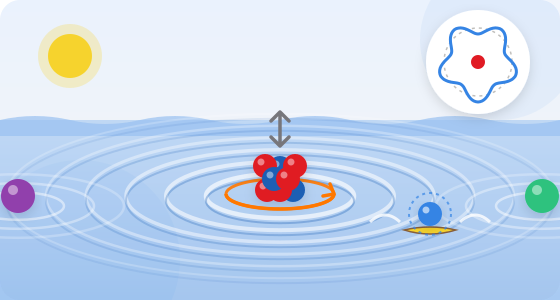
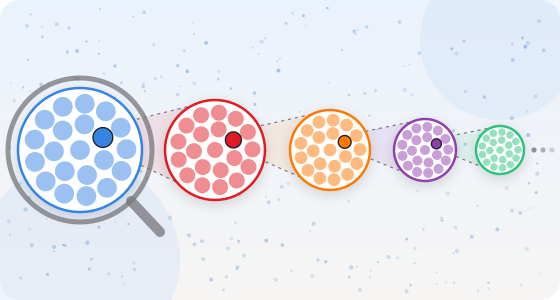

# Atom-Generator: where to start

**Atom-Generator** is the idea of a machine that assembles food and materials
from simple substances, in the spirit of Richard Feynman's lecture "There's
Plenty of Room at the Bottom" (1959).

## A story: Feynman and assembling matter

*The scene is invented — in 1937 Feynman was 19, and he gave "Plenty of
Room at the Bottom" in 1959 — but the thought is his: we know how to take
matter apart, now learn to put it together. Click the picture to enlarge it.*

## Where atoms come from

- **Hydrogen and helium** formed in the first minutes after the Big Bang:
  about ¾ of ordinary matter by mass is hydrogen, ¼ helium, plus traces of lithium.
- **Carbon, nitrogen, oxygen** — what food is made of — are forged in stars by fusion.
- **Heavier than iron** — in supernovae and neutron-star mergers.
- **Planets** form in a disk of gas and dust around a young star. Gas giants
  like Jupiter and Saturn are mostly hydrogen and helium; rocky planets like
  Earth are made of heavier elements.

**For the project:** we do not need to make atoms — turning nuclei into
other nuclei is the energy of stars. The atoms of food are already around
us: carbon in the CO₂ of air, hydrogen and oxygen in water, nitrogen in air.
The task is to **assemble molecules**: chemistry and biology. The hydrogen
lead is real, though: hydrogen is a great *energy source* — some bacteria
"eat" hydrogen and CO₂ and build protein from them.

## Steps, from proven to future

1. **Photosynthesis** — hydroponics and aquaponics can be automated today.
2. **Precision fermentation** — microbes make proteins and fats from sugar.
3. **Protein from hydrogen and CO₂** — hydrogen-oxidising bacteria in a bioreactor.
4. **Artificial photosynthesis** — CO₂ to acetate that feeds yeast and plants (research).
5. **Synthetic fats** from CO₂ and hydrogen — research and first start-ups.
6. **3D food printing** — gives shape, does not make atoms.
7. **Molecular assembly** — long-term science; in 1989 IBM researchers spelled a word with 35 xenon atoms.

## Energy budget

About 2000 kcal a day ≈ 8.4 MJ. With efficiency η the machine needs
E = 8.4 MJ / η: at η = 10 % that is 84 MJ ≈ 23 kWh per person per day.

## First steps

- [ ] Define the goal: which foods, for whom, how much per day.
- [ ] Compute energy and materials (`#energy-budget`).
- [ ] Choose a prototype path: hydroponics with sensors, a bioreactor or fermentation.
- [ ] Sensors and automation — together with the Automation server.
- [ ] Food safety: composition, purity, toxicity — verify by measurement.

## The author's hypotheses: how an atom works

*These are guesses, not established facts. Below: what agrees with known
physics, where they differ, and how to test them. Discuss in
`#atom-hypotheses`.*

**Hypothesis 1. The atom as a ball on water.**

Between the nucleus and the electrons there are micro-balls that can be
described as a wave with its own frequency. The nucleus bobs up and down and
spins, like a ball on a river, making waves around it. The electron is held
by its own frequency and the nucleus's: like a surfer on a board it is stuck
between waves and stays there. Neighbouring atoms add their waves and keep
electrons from flying off. The electron itself may be a point-wave that can
be described as a sphere.

What agrees:

- **Held by its own frequency.** In 1924 de Broglie proposed that the
  electron has a wave and an orbit is stable when a whole number of
  wavelengths fits on it (the inset, top right). That condition gives the
  energy levels of hydrogen. In quantum mechanics an electron in an atom is
  a standing wave (an orbital) around the nucleus.
- **Point and sphere at once.** In collisions the electron looks like a
  point — no structure even at 10⁻¹⁸ m — while in an atom its wave is a cloud
  of about 10⁻¹⁰ m, spherical in the lowest (1s) state.
- **The ball on water is a real experiment.** In 2005 Yves Couder and
  Emmanuel Fort found that an oil droplet bouncing on a vibrating bath moves
  by riding its own wave. These "walking droplets" show quantised orbits and
  tunnelling-like behaviour — a mechanical analogue of de Broglie's pilot wave.
- **The nucleus really moves and spins, and the electron feels it.** Both
  orbit their common centre of mass, so the spectra of hydrogen and deuterium
  differ slightly — that is how deuterium was found in 1932. The nucleus's
  spin splits the electron's levels: the 21 cm hydrogen line used to map
  the Galaxy.
- **Neighbours hold electrons.** In a crystal an electron is a wave in the
  periodic field of the atoms, with forbidden energy gaps — the basis of
  semiconductors.

Where it differs, and what to test:

- **What attracts the electron.** Standard physics: the electric force
  (− and +) pulls it in; its wave nature keeps it from falling onto the
  nucleus. The hypothesis has to explain both and give the same numbers —
  13.6 eV to ionise hydrogen and its spectrum.
- **The nucleus is ~1836 times heavier**, so its bobbing is tiny and shows
  only in precise spectroscopy.
- **What is the "water".** For several electrons the quantum wave lives in
  configuration space, not ordinary space. Bell-test experiments (Nobel prize
  2022) show that particles riding only their own local waves cannot give all
  quantum correlations: the wave must be non-local, as in de Broglie–Bohm
  theory. Walking droplets do not reproduce everything either: repeated
  double-slit runs did not confirm interference.

An experiment to build yourself: a dish of silicone oil (about 20 cSt) on a
subwoofer, a sine near 80 Hz, just below the threshold where ripples appear
by themselves (the Faraday threshold). A ~1 mm droplet bounces and walks on
its wave. Accelerometer, generator and camera — a task for the Automation
server.

**Hypothesis 2. There is no void.**

Everything smaller than an atom and its particles is made of something even
smaller — micro-balls — and division may go on forever, like a fractal. It
is only a guess.

What agrees:

- **An ancient debate.** Democritus: indivisible atoms and void. Anaxagoras:
  infinitely divisible. Descartes: no void at all.
- **Physics has no empty vacuum either.** Space is filled with quantum fields
  that fluctuate even "in emptiness"; two uncharged plates in a vacuum attract
  (the Casimir effect, measured).
- **Balls inside balls were found three times:** atom → nucleus (1911) →
  protons and neutrons → quarks (1960s).

Where the limit is, and what to test:

- **Electrons and quarks still look like points:** no electron structure
  above roughly 10⁻¹⁸–10⁻¹⁹ m, and colliders have found no quark compositeness.
- **There may be a floor:** the Planck length ≈ 1.6·10⁻³⁵ m, where today's
  theories stop working. Between 10⁻¹⁹ and 10⁻³⁵ m lie 16 untested orders of
  magnitude — room for micro-balls.
- **Related ideas in science:** "preons" inside quarks and leptons, and
  quantum-gravity approaches where space behaves like a fractal at small scales.
- **Test:** if electrons or quarks contain balls, harder collisions will
  deviate from predictions and the electron's magnetic moment will disagree
  with theory.

**Hypothesis 3. Spacetime is micro-balls-waves too.**

It depends on how you describe it: from afar a wave, up close small points —
micro-balls, which are themselves smaller waves. Spacetime may be built the
same way.

- **Everything we know already works like this.** A water wave is smooth from
  afar and molecules up close; sound in a crystal is a wave and, up close,
  vibrating atoms (phonons); light is a wave yet arrives in a detector as
  points — photons.
- **Similar approaches in physics:** causal set theory treats spacetime as a
  set of discrete points; in loop quantum gravity area and volume come in
  smallest portions.
- **Test:** if space is grainy, light of different frequencies may travel at
  slightly different speeds. Gamma-ray bursts from across the Universe have
  not shown this yet — grains, if any, are very small, near the Planck scale
  or below.

**For Atom-Generator.** Food is assembled at the level of molecules, and a
chemical bond *is* electron waves between atoms. If hypothesis 1 suggests how
to "tune the frequencies" of bonds (catalysts and light of the right
wavelength already do this), the machine can use it directly.

## Reading

- [Richard Feynman, "There's Plenty of Room at the Bottom" (1959)](https://en.wikipedia.org/wiki/There%27s_Plenty_of_Room_at_the_Bottom)
- [Big Bang nucleosynthesis](https://en.wikipedia.org/wiki/Big_Bang_nucleosynthesis)
- [Stellar nucleosynthesis](https://en.wikipedia.org/wiki/Stellar_nucleosynthesis)
- [Matter waves (de Broglie)](https://en.wikipedia.org/wiki/Matter_wave)
- [John Bush, "Pilot-wave hydrodynamics" — walking droplets review](https://dspace.mit.edu/handle/1721.1/89790)
- [Casimir effect — the vacuum is not empty](https://en.wikipedia.org/wiki/Casimir_effect)

---

*The map is not the territory: this is a starting plan — check it and extend it.*
