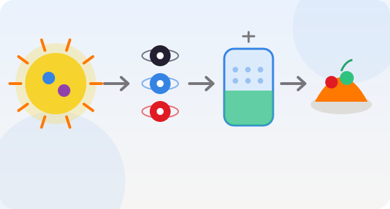
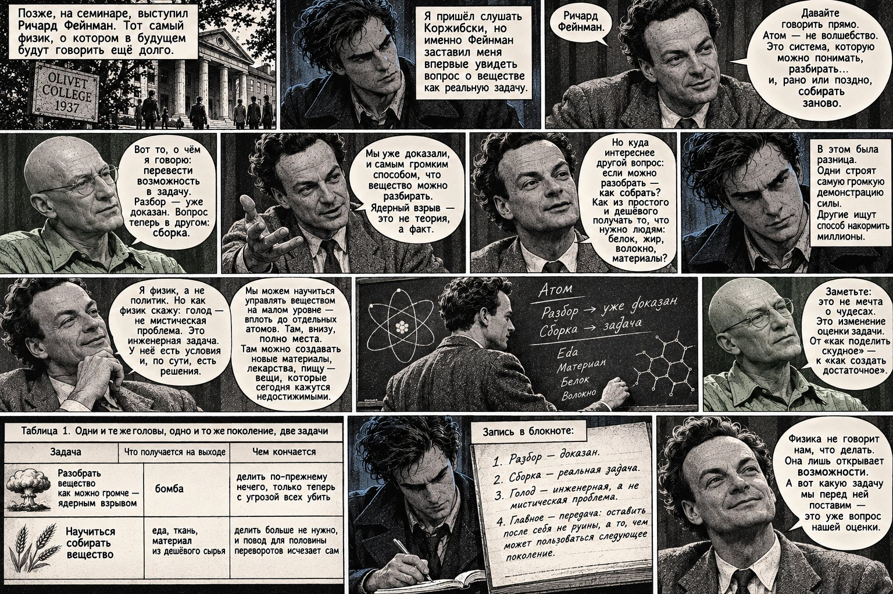
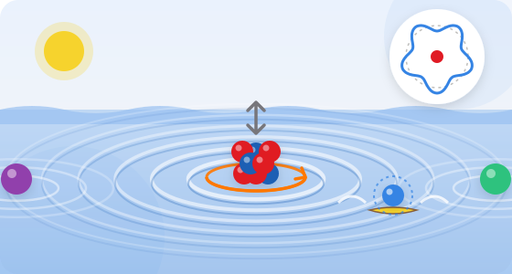
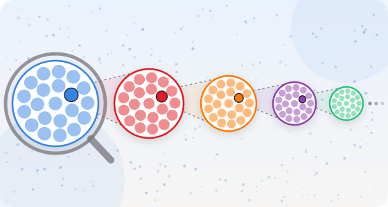

# Atom-Generator: с чего начать

**Atom-Generator** — идея машины, которая собирает еду и материалы из простых
веществ, в духе лекции Ричарда Фейнмана «Там внизу полно места» (1959). Ниже —
что известно науке сегодня и с чего реально начать.

## История: Фейнман и сборка вещества

*Сцена придумана: в 1937 году Фейнману было 19 лет, а лекцию «Там внизу
полно места» он прочитал в 1959-м. Но мысль — разобрать вещество умеем,
теперь научиться собирать — из неё. Нажмите на картинку, чтобы увеличить.*

## Откуда берутся атомы

- **Водород и гелий** появились в первые минуты после Большого взрыва:
  примерно ¾ массы обычного вещества — водород, ¼ — гелий, плюс следы лития.
- **Углерод, азот, кислород** — то, из чего состоит еда, — рождаются в звёздах:
  термоядерный синтез превращает водород в гелий, гелий — в углерод и
  кислород и дальше, до железа.
- **Тяжелее железа** — во взрывах сверхновых и при слияниях нейтронных звёзд.
- **Планеты** образуются в диске газа и пыли вокруг молодой звезды. Газовые
  гиганты, как Юпитер и Сатурн, в основном состоят из водорода и гелия.
  Каменные планеты, как Земля, — из более тяжёлых элементов (железо,
  кислород, кремний, магний): лёгкие водород и гелий их не удержали.

**Вывод для проекта.** Водород и гелий — действительно ключ к рождению звёзд и
планет, но «делать атомы» нам не нужно: превращать одни ядра в другие — это
энергия звёзд. Атомы еды уже вокруг: углерод — в CO₂ воздуха, водород и
кислород — в воде, азот — в воздухе, минералы — в земле. Задача
Atom-Generator — **собрать из них молекулы**: это химия и биология.

**А вот зацепка с водородом есть:** водород — отличный *источник энергии*.
Существуют бактерии, которые «едят» водород и CO₂ и строят из них белок.
Водород можно получать электролизом воды от солнца или ветра — получается
белок из воздуха, воды и электричества.

## Из чего состоит еда

- **Углеводы** и **жиры** — углерод, водород, кислород (C, H, O).
- **Белки** — ещё азот и сера (N, S).
- **Минералы и витамины** — кальций, калий, натрий, магний, железо, фосфор и др.

## Ступени — от проверенного к будущему

1. **Фотосинтез** — природный «атомный генератор»: CO₂ + вода + свет → сахара.
   Гидропоника и аквапоника — управляемая версия, её можно автоматизировать
   уже сейчас.
2. **Прецизионная ферментация** — микроорганизмы производят нужные белки и
   жиры из сахара.
3. **Белок из водорода и CO₂** — водородокисляющие бактерии в биореакторе.
4. **Искусственный фотосинтез** — электрохимия превращает CO₂ в ацетат,
   которым питаются дрожжи и даже растения без света (исследования).
5. **Синтетические жиры** из CO₂ и водорода — исследования и первые
   стартапы.
6. **3D-печать еды** — придаёт форму, но атомы не создаёт.
7. **Молекулярная сборка** по Фейнману — долгосрочная наука. Уже в 1989 году
   учёные IBM выложили слово из 35 атомов ксенона сканирующим туннельным
   микроскопом — атомы можно двигать по одному.

## Энергетический бюджет

Человеку нужно около 2000 ккал в день ≈ 8,4 МДж. Если машина переводит
энергию в еду с КПД η, ей нужно E = 8,4 МДж / η. При η = 10 % это 84 МДж ≈
23 кВт·ч на человека в день. Поэтому первый вопрос любого прототипа —
**откуда энергия** (солнце, ветер) и какой КПД.

## Первые шаги

- [ ] Описать цель: какие продукты, для кого, сколько в день.
- [ ] Посчитать энергию и материалы (канал `#energy-budget`).
- [ ] Выбрать путь прототипа: гидропоника с датчиками, биореактор или
      ферментация.
- [ ] Датчики и автоматика — вместе с сервером Automation.
- [ ] Безопасность еды: состав, чистота, токсичность — проверять измерениями.
- [ ] Записывать всё в LaTeX-концепцию (`#latex-docs`), с датами и
      индексами версий.

## Гипотезы автора: как устроен атом

*Это догадки, а не установленные факты. Ниже — что в них совпадает с
известной физикой, где они расходятся и как их проверить. Обсуждение — в
канале `#atom-hypotheses`.*

**Гипотеза 1. Атом как мяч на воде.**

Между ядром и электронами есть микро-шарики, которые можно описать волной
со своей частотой. Ядро колеблется вверх-вниз и крутится, как мяч на воде в
реке, и создаёт вокруг волны. Электрон удерживается своей частотой и
частотами ядра: как сёрфер на доске, он застрял между волнами и там сидит.
Соседние атомы тоже дают волны и не дают электронам вылететь. Сам электрон,
возможно, — точка-волна, которую можно описать как сферу.

Что с этим совпадает:

- **Электрон держится «своей частотой».** В 1924 году де Бройль предложил,
  что у электрона есть волна, а орбита устойчива, когда на ней укладывается
  целое число длин волн (кружок справа вверху на картинке). Из этого условия
  получаются уровни энергии водорода. В современной квантовой механике
  электрон в атоме — стоячая волна (орбиталь) вокруг ядра.
- **Точка и сфера сразу.** В столкновениях электрон ведёт себя как точка:
  структуры не видно даже на 10⁻¹⁸ м. А в атоме его волна — облако около
  10⁻¹⁰ м, на нижнем уровне (1s) оно сферическое. «Точка-волна-сфера» —
  довольно точное описание.
- **Мяч на воде — настоящий опыт.** В 2005 году Ив Кудер и Эммануэль Фор
  обнаружили: капля масла прыгает по вибрирующей ванне и движется, оседлав
  собственную волну. У таких «шагающих капель» есть квантованные орбиты и
  подобие туннелирования. Это механический аналог волны-пилота де Бройля —
  почти ваш сёрфер.
- **Ядро правда двигается и крутится, и электрон это чувствует.** Ядро и
  электрон вращаются вокруг общего центра масс, поэтому спектры водорода и
  дейтерия (ядро вдвое тяжелее) немного различаются — так в 1932 году открыли
  дейтерий. Вращение ядра (спин) слегка расщепляет уровни электрона — отсюда
  радиолиния водорода 21 см, по которой картируют Галактику.
- **Соседи держат электроны.** В кристалле электрон — волна в периодическом
  поле соседних атомов, и есть «запрещённые» энергии, где ему быть нельзя.
  На этом работают полупроводники.

Где расхождения и что проверить:

- **Что притягивает электрон.** В стандартной физике электрон притягивает к
  ядру электрическое поле (заряды − и +), а упасть на ядро не даёт его
  волновая природа. Гипотеза должна объяснить и притяжение, и то, почему
  электрон не падает, — и дать те же числа: энергия ионизации водорода 13,6 эВ
  и его спектр.
- **Ядро в ~1836 раз тяжелее электрона**, поэтому его «качание» очень мало —
  оно видно только в точной спектроскопии (как у дейтерия).
- **Что за «вода».** У нескольких электронов волна квантовой механики живёт не
  в обычном пространстве, а в «пространстве конфигураций». Опыты с
  неравенствами Белла (Нобелевская премия 2022 года) показали: если каждая
  частица едет только на своей местной волне, всех квантовых корреляций не
  получить. Волна-«вода» должна быть нелокальной, как в теории
  де Бройля–Бома. И шагающие капли повторяют не всё: интерференцию за двумя
  щелями повторные опыты не подтвердили.

Опыт, который можно собрать самому: ванночка силиконового масла (около
20 сСт) на сабвуфере, синус около 80 Гц, амплитуда чуть ниже порога, когда
по поверхности сама идёт рябь (порог Фарадея). Капля около 1 мм начинает
прыгать и «шагать» по своей волне. Акселерометр, генератор и камера —
задача для сервера Automation.

**Гипотеза 2. Пустоты нет.**

Всё, что меньше атома и его частиц, состоит из ещё более мелкого — из
микро-шариков. Возможно, делить можно бесконечно, как во фрактале. Это
лишь догадка.

Что с этим совпадает:

- **Спор древний.** Демокрит считал, что есть неделимые атомы и пустота;
  Анаксагор — что делить можно бесконечно; Декарт — что пустоты нет вовсе.
- **Пустого вакуума в физике действительно нет.** Пространство заполнено
  квантовыми полями, они флуктуируют даже «в пустоте». Это измерено: две
  незаряженные пластины в вакууме притягиваются (эффект Казимира).
- **«Шарики внутри шариков» находили уже трижды:** атом → ядро (1911) →
  протоны и нейтроны → кварки (1960-е).

Где граница и что проверить:

- **Электрон и кварки пока выглядят точками.** У электрона нет структуры
  крупнее примерно 10⁻¹⁸–10⁻¹⁹ м; коллайдеры ищут «составность» кварков и
  пока ничего не нашли.
- **Может быть нижний предел.** Планковская длина ≈ 1,6·10⁻³⁵ м — масштаб,
  где нынешние теории перестают работать. Между 10⁻¹⁹ и 10⁻³⁵ м — 16
  порядков, которые никто не проверял: место для микро-шариков есть.
- **Похожие научные идеи:** «преоны» — частицы внутри кварков и лептонов; и
  подходы к квантовой гравитации, где пространство на малых масштабах ведёт
  себя как фрактал.
- **Проверка:** если внутри электрона или кварка есть шарики, при более
  сильных столкновениях появятся отклонения от расчётов, а магнитный момент
  электрона разойдётся с теорией.

**Гипотеза 3. Пространство-время — тоже микро-шарики-волны.**

Смотря как описывать: издалека это волна, а если приблизиться — мелкие
точки, микро-шарики, которые сами тоже волны поменьше. Пространство-время
может быть устроено так же.

- **Так уже устроено всё, что мы знаем.** Волна на воде издалека гладкая, а
  вблизи — молекулы. Звук в кристалле — волна, а вблизи — колебания атомов
  (кванты звука, фононы). Свет — волна, а в детекторе приходит точками,
  фотонами.
- **В физике есть похожие подходы:** теория причинных множеств считает
  пространство-время набором дискретных точек; в петлевой квантовой гравитации
  площадь и объём состоят из минимальных порций.
- **Проверка:** если пространство «зернистое», свет разной частоты может
  идти чуть с разной скоростью. Гамма-всплески с другого конца Вселенной
  этого пока не показали — зёрна, если есть, очень мелкие, у планковского
  масштаба или ниже.

**Для Atom-Generator.** Для сборки еды важен уровень молекул, а химическая
связь — это и есть волны электронов между атомами. Если гипотеза 1 подскажет,
как «настраивать частоты» связей (это уже делают катализаторы и свет нужной
длины волны), она пригодится машине напрямую.

## Каналы сервера

- `#concept-overview` — цель, требования, открытые вопросы.
- `#feynman-plenty-of-room` — лекция Фейнмана и наномасштаб.
- `#molecular-assembly` — химия, биология, сборка молекул.
- `#atom-hypotheses` — гипотезы о строении атома и их проверка.
- `#energy-budget` — расчёты энергии и КПД.
- `#latex-docs` — документация проекта.

## Почитать

- [Ричард Фейнман, «Там внизу полно места» (1959)](https://en.wikipedia.org/wiki/There%27s_Plenty_of_Room_at_the_Bottom)
- [Первичный нуклеосинтез — откуда водород и гелий](https://ru.wikipedia.org/wiki/Первичный_нуклеосинтез)
- [Звёздный нуклеосинтез — откуда углерод и кислород](https://ru.wikipedia.org/wiki/Звёздный_нуклеосинтез)
- [Волна де Бройля](https://ru.wikipedia.org/wiki/Волна_де_Бройля)
- [John Bush, «Pilot-wave hydrodynamics» — обзор о шагающих каплях (англ.)](https://dspace.mit.edu/handle/1721.1/89790)
- [Эффект Казимира — вакуум не пуст](https://ru.wikipedia.org/wiki/Эффект_Казимира)

---

*Карта — не территория: это стартовый план, его стоит проверять и дополнять.*
