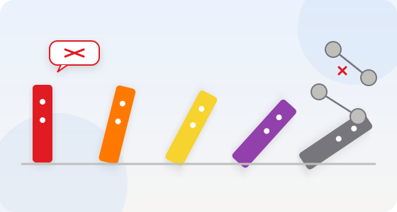
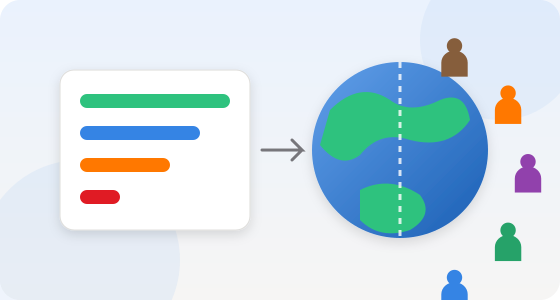

# The price of words

This is the tenth message with an insult. Nothing has been blocked and nothing will be. Just look at what it adds up to.

## How escalation works

A word → the same in return → resentment → camps of "us" and "them" → people leave → the work stops. Every step is small; the sum is large.

In cybernetics this is **positive feedback**: each reply amplifies the next, and the system runs away. Stability comes from negative feedback, from the one who damps the swing instead of pushing it. Any of us can be that one.

## What we pay here

- **Time**: arguments instead of work.
- **People**: the quietest and most useful leave first.
- **Trust**: a network without servers has no moderator; trust between people is the infrastructure.
- **The project**: break things and nothing will work; we will only lose time.

## What the planet pays

The same mechanisms work at large scale. A war does not begin with weapons but with words: the label "enemy", "they are not like us", "they are not human". Once a person is no longer seen behind the label, anything can be done to them.

Conflicts take lives, years, resources and the attention of scientists and engineers. What could go to food, housing, clean energy and education goes to destruction and to rebuilding after it.

## Time-binding

Korzybski called humans "time-binders": each generation builds on the knowledge of the ones before. Hostility breaks that chain; what was accumulated is spent on fighting instead of being passed on. He himself came to general semantics after returning from the First World War.

## What you can do right now

- Re-read your last message: what did you actually want to say?
- If you hurt someone, "I went too far" is worth a lot and builds a bridge.
- Talk about facts and actions, not about people.
- Pause before you answer.

## Step one

**Wars must stop. Step one is to start with yourself, in your own relations with people.**

- [General semantics — materials (archive.org)](https://archive.org/details/general-semantic-2024)

Special thanks to Mikhail Korotkov for the translations.

---

*There are no limits here and no bans. You are responsible for the future.*
