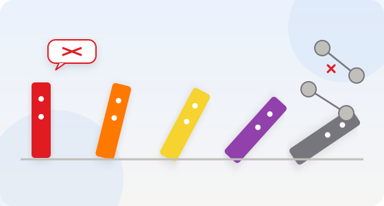

# Цена слов

Это десятое сообщение с оскорблением. Ничего не заблокировано и не будет. Просто посмотрите, во что это складывается.

## Как работает эскалация

Слово → ответ тем же → обида → лагеря «мы» и «они» → люди уходят → работа встаёт. Каждый шаг маленький, сумма — большая.

В кибернетике это **положительная обратная связь**: каждый ответ усиливает следующий, и система идёт вразнос. Устойчивость даёт отрицательная обратная связь — тот, кто гасит колебание, а не раскачивает его. Таким может стать любой из нас.

## Чем платим здесь

- **Временем** — споры вместо работы.
- **Людьми** — первыми уходят самые тихие и самые полезные.
- **Доверием** — в сети без серверов нет модератора; доверие между людьми и есть инфраструктура.
- **Проектом** — будем ломать, ничего не получится, затянем по времени.

## Чем платит планета

Те же механизмы работают в большом масштабе. Война начинается не с оружия, а со слов: ярлык «враг», «они не такие, как мы», «они не люди». Когда человека перестают видеть за ярлыком, с ним становится можно сделать что угодно.

Конфликты забирают жизни, годы, ресурсы и внимание учёных и инженеров. То, что могло пойти на еду, жильё, чистую энергию и образование, уходит на разрушение и восстановление после него.

## Связывание времени

Коржибски называл людей «связывателями времени»: каждое поколение строит на знаниях предыдущих. Вражда рвёт эту цепь — накопленное тратится на борьбу, а не передаётся дальше. Сам он пришёл к общей семантике, вернувшись с Первой мировой.

## Что можно сделать прямо сейчас

- Перечитать последнее сообщение: что вы хотели сказать на самом деле?
- Если задели человека — «я перегнул» стоит дорого и строит мост.
- Говорить о фактах и поступках, а не о людях.
- Сделать паузу перед ответом.

## Шаг первый

**Войны надо прекращать. Шаг первый — начать с себя в своих отношениях с людьми.**

- [Наука о Человеке: Общая семантика — что это и зачем нужно? (PDF)](../assets/pdf/general-semantics.pdf)
- [Общая семантика — материалы (archive.org)](https://archive.org/details/general-semantic-2024)

Михаилу Короткову — отдельная благодарность за переводы.

---

*Тут нет лимитов, тут нет банов. Вы отвечаете за будущее.*
